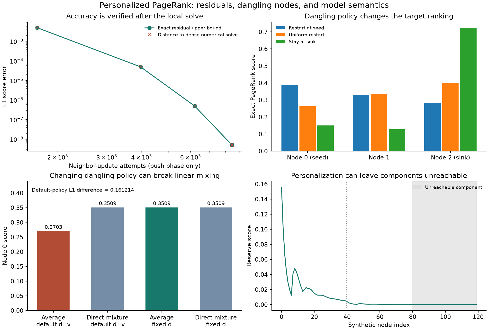

# Personalized rank residuals

[](https://github.com/lcx0731/personalized-rank-residuals/actions/workflows/ci.yml)

Personalized PageRank with a local FIFO push solver and an **independent rational
residual check**. The solver uses floats; verification recomputes the error bound
against the original integer-weight graph using exact fractions.

The project separates two questions: *how accurately was a specified ranking
computed?* and *which ranking did the model actually specify?* A small residual
answers the first. It does not fix an unintended rule for nodes without outgoing
edges. Synthetic examples also show how changing the transition matrix can break
linear mixing of personalized rankings.



All graphs are deterministic synthetic examples generated here, not measurements
of a real network. The code is an original educational implementation of standard
PageRank ideas. No private data, downloaded graph, or external dataset is used.

## Reproduce

Python 3.11 or 3.13:

```bash
python3 -m venv .venv
source .venv/bin/activate
python -m pip install -r requirements-repro.txt
python -m pip install --no-deps .
python -m pip check
python -m pytest -q
python -m rank_residuals.demo --output results
rank-residuals rank results/example.json
rank-residuals verify results/verification.json
```

The core and CLI need only the Python standard library (`pip install .`).
NumPy is used for a larger numerical reference in the demo, Matplotlib for the
figure, and pytest for tests. `requirements-repro.txt` pins the reproduction
environment. CI runs tests, the complete demo, and both installed CLI operations
on Python 3.11 and 3.13.

The demo creates a summary, an input example, its rank result, a separate verifier
request, and a PNG. It uses no randomness. Small tests select reproducible graphs
using seeds 0–11 and then solve those graphs exactly. The larger dense numerical
reference can vary in its last bits across linear algebra libraries.

## Specify the model

Nodes are integers 0 through `nodes−1`. Each edge is `[source,target,weight]`
with a positive integer weight. Parallel edge weights add; self-loops are allowed.
For a nonempty row, transition probabilities are its weights divided by their
sum. A node without outgoing edges is **dangling**, and its transition row is
replaced by the distribution d.

The personalization weights specify a distribution v. If `dangling` is omitted,
d=v; an explicit integer-weight vector instead keeps d fixed. Omitted
personalization is uniform. This default dangling convention also appears in
[NetworkX's PageRank interface](https://networkx.org/documentation/stable/reference/algorithms/generated/networkx.algorithms.link_analysis.pagerank_alg.pagerank.html).

With a row-stochastic transition matrix P, the target column vector p satisfies

```text
p = (1−alpha) v + alpha Pᵀ p,       0 <= alpha < 1.
```

Here alpha is the probability of continuing along a graph transition; 1−alpha
is the restart probability. Some literature uses alpha for restart instead.
The contraction gives a unique target even when v has zeros and the graph is
reducible. Unreachable nodes can legitimately have score zero.

```json
{
  "nodes": 4,
  "edges": [[0,1,3], [0,2,1], [1,2,2], [2,0,1]],
  "personalization": [1,0,0,0],
  "alpha": "17/20",
  "tolerance": 1e-8,
  "top_k": 2
}
```

Alpha must be exact: a fraction/decimal string such as `"17/20"` or `"0.85"`,
an integer, or a Python `Fraction`. A JSON floating-point alpha is rejected.
Graph and distribution weights must be nonnegative/positive integers as stated,
so verification has a precise rational model rather than rounded transitions.

```python
from rank_residuals import Graph, rank, verify

graph = Graph(3, [(0, 1, 1), (1, 2, 1)])
result = rank(graph, personalization=[1,0,0], alpha="1/2", top_k=1)
check = verify(graph, result["scores"], personalization=[1,0,0],
               alpha="1/2", top_k=1)
assert check == result["certificate"]
# Target scores are exactly 4/7, 2/7, 1/7.
```

## Float solver, exact post-verification

The forward push starts with reserve x=0 and pending mass r=v. Pushing node i
removes its pending mass delta, adds `(1−alpha)*delta` to x_i, and sends
`alpha*delta` through row i. A FIFO queue holds nodes with pending mass, without
duplicate active entries. Self-loop mass is requeued after removing the old mass.
The general forward-push approach and its reserve/residual interpretation are
described in [Lofgren's thesis, §2.4](https://www-cs.stanford.edu/people/plofgren/bidirectional_ppr_thesis.pdf).

In exact arithmetic, `p = x + (1−alpha)(I−alpha Pᵀ)⁻¹ r`, so the unprocessed
nonnegative mass equals the L1 error. That identity guides the float solver's
stopping rule, but floating-point pending mass is **not** used as its final proof.
The solver aims for half the requested tolerance, checks mass periodically with
`math.fsum`, and then calls the independent verifier.

For the candidate x, the verifier recomputes

```text
b = (1−alpha) v + alpha Pᵀ x − x
B = ||b||_1 / (1−alpha)
```

entirely using `Fraction`. Each candidate score is interpreted as the **exact
binary floating-point number supplied**, via `Fraction.from_float`. Since Pᵀ
has induced L1 norm 1, the Neumann series gives

```text
||p−x||_1 <= ||(I−alpha Pᵀ)⁻¹||_1 ||b||_1 <= B.
```

This bound includes errors from float transition normalization and all preceding
float solver operations. It does not rely on queue invariants, reported iteration
counts, or a convergence flag. Verification can also check a candidate produced
by a different algorithm. Scores may even be negative; the residual bound still
holds, although such candidates are usually poor probability approximations.

The certificate stores B as a rational string. Its convenience float is rounded
upward if needed, never below the exact bound. `tolerance_met` compares B against
the exact binary representation of the supplied float tolerance. There is no
statistical confidence level: this is a deterministic bound for this exact graph
model and candidate. It says nothing about graph measurement errors or relevance.

### What the top-k claim proves

Scores are sorted descending, with node index breaking ties. Let g be the score
gap between positions k and k+1. If `g > B`, every selected node's true score is
strictly above every excluded node's score: pairwise error is at most
`|e_i|+|e_j| <= ||e||_1 <= B`. The certificate then sets
`top_k_membership_proved=true`. It proves membership, **not the internal order**
of those k nodes. Ties or a small gap remain unproved. For k=n the whole-node
membership statement is vacuously true.

## CLI reports and stopping

`rank-residuals rank input.json` returns reserve scores, remaining push mass,
work counts, status, and the independent certificate. It deliberately does not
renormalize the unfinished reserve vector. Renormalization changes the candidate
and requires a new verification.

To use `rank-residuals verify input.json`, provide the same graph/model fields
and a `scores` array instead of `max_pushes`. The generated `verification.json`
is a complete example. Changing an edge, alpha, v, or d changes what is verified;
a report is not a cryptographic attestation of its input.

Statuses are `converged` when the exact bound meets the tolerance,
`budget_exhausted` when the push cap is reached without meeting it, and
`verification_limit` when the float stopping criterion is met but the exact
check fails. The latter two still return a valid bound and an explicit failure
status. A small update or exhaustion never silently counts as convergence.

CLI exit codes are 0 for a tolerance-verified result, 3 for a valid report that
does not meet tolerance, 1 for invalid input/read errors, and 2 for usage errors.
Unknown/duplicate fields, nonfinite numbers, booleans as counts, and malformed
edges are rejected. Input files are read without modification.

## Why mixing personalized results can fail

If P is fixed, the solution is linear in v. If dangling rows are set to each
query's personalization, P itself depends on v, so that argument no longer
applies. The two-node graph `0 -> 1`, with node 1 dangling and alpha=17/20,
gives an exact counterexample:

| Operation | Node 0 | Node 1 |
|---|---:|---:|
| Average the v=(1,0) and v=(0,1) solutions, each using d=v | 10/37 | 27/37 |
| Solve directly for v=(1/2,1/2), d=v | 20/57 | 37/57 |
| Average the same two solutions, both with fixed d=(1/2,1/2) | 20/57 | 37/57 |

The default-policy L1 discrepancy is exactly `340/2109`, about 0.161214.
This is a change of transition model, not an approximation or solver error.
With fixed uniform d, the mixture identity holds exactly in the rational reference.

## Validation and limitations

### Reproduced examples

The larger synthetic graph has 120 nodes in three 40-node blocks and 235 directed
weighted edges. Within each block, nodes 0–38 relative to the block start point
one step forward with weight 3 and seven steps forward modulo 40 with weight 1.
The final node of each block is dangling. One additional edge of weight 1 goes
from node 15 to node 40. Personalization restarts at node 0, alpha=17/20, and
dangling rows use that same personalization. The final block is unreachable.
Full raw edge records are saved in [results/summary.json](results/summary.json).

| Requested L1 tolerance | Pushes | Neighbor-update attempts | Verified L1 bound (rounded) | Top-5 set proved? |
|---|---:|---:|---:|---|
| 1e−2 | 848 | 1,688 | 4.971176e−3 | No |
| 1e−4 | 1,994 | 3,966 | 4.991617e−5 | Yes |
| 1e−6 | 3,122 | 6,207 | 4.966862e−7 | Yes |
| 1e−8 | 4,256 | 8,462 | 4.963570e−9 | Yes |

Table decimals are rounded summaries; the returned rational certificate and
upward-rounded float are the authoritative bounds. Neighbor counts include
dangling redistribution and exclude initialization, output, and full-graph exact
verification. They do not measure runtime. The tightest run has 80 nonzero
reserve scores and top-five node set `{0,1,2,8,9}`. Its set membership is proved
by the residual/gap test. The plotted numerical-reference differences nearly
coincide with the bounds because forward push retains unprocessed mass. The
120-node dense numerical reference is itself checked by the rational verifier
(development-run error bound approximately 7.01e−16); it is not labeled exact.

A separate three-node chain `0 -> 1 -> 2` with personalization at node 0 shows
the effect of the dangling rule at node 2:

| Dangling distribution | Node 0 score | Node 1 score | Node 2 score |
|---|---:|---:|---:|
| Restart at seed | 400/1029 | 340/1029 | 289/1029 |
| Uniform over three nodes | 571/2169 | 731/2169 | 289/723 |
| Stay at node 2 | 3/20 | 51/400 | 289/400 |

These are exact rational solutions at alpha=17/20. The leading node changes
from node 0 to node 2 without changing any recorded graph edge or personalization
weight. The dangling rule is part of the model and must be specified deliberately.

### Independent references and tests

An independent small-case reference builds a dense transition matrix directly
from raw edge records and solves the rational linear system by Gaussian
elimination. It never calls the production graph normalization, push, or verifier
functions. The 63 tests compare exact score errors against the claimed bound on seeded
weighted graphs with dangling nodes and loops. They also cover exhausted budgets,
analytic chain scores, self-loops, parallel edges, weight-scale and node-permutation
invariance, unreachable components, top-k ties, mixture semantics, and strict CLI
round trips. A rounding example verifies that `[1/3,1/3,1/3]` as floats has exact
L1 error `1/2^54` relative to the uniform rational vector, despite apparently
perfect displayed decimals.

The core is intentionally bounded: 1–200 nodes, at most 10,000 input edges,
integer weights up to 1e9 per input edge/distribution entry, rational alpha
denominator at most 1,000,000, tolerances in [1e−12,1], and 0–200,000 pushes
(default 100,000). Candidate score magnitudes are at most 1e6; CLI input is at
most 1 MiB. The exact dense reference is limited to 12 nodes.

Local push work is proportional to visited outgoing entries (a dangling push
visits all positive entries of d), plus queue operations and periodic O(n)
mass sums. Initialization, output, and the final verifier scan the entire graph.
Fraction numerator/denominator growth affects verification cost. Therefore local
work counts are **not** wall-clock speedups or sublinear end-to-end guarantees.
There is no web-scale performance, dynamic graph update, or benchmark claim.

Graphs are fixed and fully known. The project does not infer graph edges, learn
personalization, validate relevance, correct selection bias, or model uncertainty
in the graph. Close-to-one alpha can require many pushes and amplify residual
error bounds. Different dangling conventions are different targets, not interchangeable
implementation details. Numerical accuracy does not establish ranking quality.

## Files

- `src/rank_residuals/core.py`: weighted graph, FIFO solver, exact residual bound,
  and top-set separation check.
- `src/rank_residuals/reference.py`: independent rational dense solve.
- `src/rank_residuals/cli.py`: rank and verify commands.
- `src/rank_residuals/demo.py`: synthetic graph construction, exact contrasts,
  larger numerical reference, and figure.
- `tests/`: exact-oracle comparisons, invariances, boundaries, and CLI checks.
- `results/`: generated summaries, examples, verification request, and plot.

Original code under the [MIT License](LICENSE). Standard methods and conventions
are attributed above; no external dataset is used.
